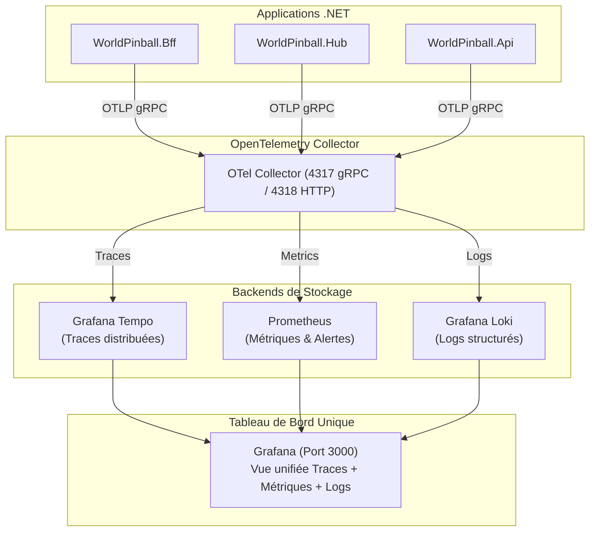

# 🔭 Cheatsheet Architecture : Observabilité Complète (.NET / OpenTelemetry / Grafana Stack)

> **Tags :** #dotnet #observability #opentelemetry #tempo #prometheus #loki #grafana #aspire #obsidian
> **Projet de référence :** `WorldPinball.Api/Extensions/ObservabilityExtensions.cs` & `docker/observability/dev/`

---

## 🎯 Les 3 Piliers de l'Observabilité (Le Triptyque OTel)

Dans un système microservices distribué (BFF, Hub, Leaderboard), quand une requête plante ou ralentit, il est impossible de chercher à l'aveugle dans des fichiers logs isolés. On utilise les 3 piliers corrélés :

1. **Traces (Tempo / Jaeger) :** Suivre le chemin d'une requête de bout en bout (`TraceId` unique) : `Navigateur -> BFF -> Hub -> Postgres/Redis -> RabbitMQ`.
2. **Metrics (Prometheus) :** Mesurer la santé globale en temps réel (taux d'erreur 5xx, requêtes/sec, temps de réponse p95/p99, connexions DB).
3. **Logs (Loki / Serilog) :** Les messages contextuels structurés liés directement au `TraceId` de la requête.

---

## 📐 Architecture du Pipeline de Télémétrie



---

## 🏗️ Guide de Branchement en 5 Étapes

### Étape 1 : Les Packages NuGet Indispensables
Dans ton projet .NET (`.csproj`) :
```xml
<ItemGroup>
  <!-- OpenTelemetry Core & Hosting -->
  <PackageReference Include="OpenTelemetry.Extensions.Hosting" Version="1.9.0" />
  <PackageReference Include="OpenTelemetry.Exporter.OpenTelemetryProtocol" Version="1.9.0" />
  
  <!-- Instrumentations automatiques -->
  <PackageReference Include="OpenTelemetry.Instrumentation.AspNetCore" Version="1.9.0" />
  <PackageReference Include="OpenTelemetry.Instrumentation.Http" Version="1.9.0" />
  <PackageReference Include="OpenTelemetry.Instrumentation.StackExchangeRedis" Version="1.9.0-beta.1" />
  <PackageReference Include="Npgsql.OpenTelemetry" Version="8.0.3" />
</ItemGroup>
```

---

### Étape 2 : L'Extension C# (`Extensions/ObservabilityExtensions.cs`)
Configure OpenTelemetry en 30 lignes de code :
```csharp
using Npgsql;
using OpenTelemetry.Metrics;
using OpenTelemetry.Resources;
using OpenTelemetry.Trace;

namespace WorldPinball.Api.Extensions;

public static class ObservabilityExtensions
{
    public static WebApplicationBuilder AddObservability(this WebApplicationBuilder builder, string serviceName)
    {
        var otlpEndpoint = builder.Configuration["OTEL_EXPORTER_OTLP_ENDPOINT"];

        var otel = builder.Services.AddOpenTelemetry()
            .ConfigureResource(resource => resource.AddService(serviceName, serviceInstanceId: Environment.MachineName))
            .WithTracing(tracing =>
            {
                tracing
                    .AddAspNetCoreInstrumentation(opts =>
                    {
                        // Ignore les health checks pour ne pas polluer les traces
                        opts.Filter = httpContext => !httpContext.Request.Path.StartsWithSegments("/health");
                    })
                    .AddHttpClientInstrumentation()
                    .AddNpgsql()              // Capture toutes les requêtes SQL PostgreSQL
                    .AddRedisInstrumentation(); // Capture toutes les commandes Redis
            })
            .WithMetrics(metrics =>
            {
                metrics
                    .AddAspNetCoreInstrumentation()
                    .AddHttpClientInstrumentation();
            });

        // Si l'endpoint du collecteur est configuré, active l'exporteur OTLP
        if (!string.IsNullOrWhiteSpace(otlpEndpoint))
        {
            otel.UseOtlpExporter();
        }

        return builder;
    }
}
```

---

### Étape 3 : Branchement dans `Program.cs`
Une seule ligne suffit dans ton point d'entrée :
```csharp
var builder = WebApplication.CreateBuilder(args);

// Branche l'observabilité OTel
builder.AddObservability("WorldPinball.Api");

var app = builder.Build();
...
app.Run();
```

---

### Étape 4 : Configuration dans Docker Compose (`docker-compose.override.yml`)
Chaque conteneur .NET doit simplement connaître l'adresse du conteneur `otel-collector` :
```yaml
services:
  core-api:
    environment:
      # Port 4317 = OTLP gRPC par défaut
      OTEL_EXPORTER_OTLP_ENDPOINT: "http://worldpinball-otel-collector:4317"
      OTEL_SERVICE_NAME: "core-api"

  hub:
    environment:
      OTEL_EXPORTER_OTLP_ENDPOINT: "http://worldpinball-otel-collector:4317"
      OTEL_SERVICE_NAME: "hub"

  bff:
    environment:
      OTEL_EXPORTER_OTLP_ENDPOINT: "http://worldpinball-otel-collector:4317"
      OTEL_SERVICE_NAME: "bff"
```

---

### Étape 5 : La Stack Docker Observabilité (`docker-compose.observability.yml`)
Lance la stack complète (Collector + Tempo + Prometheus + Loki + Grafana) :
```bash
docker compose -f docker/observability/dev/docker-compose.observability.yml up -d
```

Ports d'accès utiles :
* **Grafana :** `http://localhost:3000` (User: `admin` / Pas de mot de passe requis en dev)
* **Prometheus :** `http://localhost:9090` (Explorateur de requêtes PromQL)
* **Tempo :** `http://localhost:3200`
* **OTel Collector :** `http://localhost:4317` (gRPC) & `:4318` (HTTP)

---

## ⚡ La Corrélation Magique dans Grafana

Le super-pouvoir de cette stack :
1. Tu cliques sur un pic de lenteur dans **Prometheus**.
2. Grafana t'affiche immédiatement les **Traces Tempo** associées à ce pic.
3. Tu cliques sur la trace : tu vois exactement que c'est la requête `SELECT FOR UPDATE SKIP LOCKED` sur PostgreSQL qui a pris 450 ms !
4. Un bouton te permet de sauter directement aux **Logs Loki** filtrés sur le même `TraceId`.

Zéro devinette, diagnostic en 30 secondes chrono ! 🎯🔍
