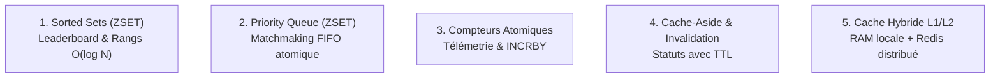

# ⚡ Cheatsheet Architecture : Redis Patterns & StackExchange.Redis (.NET / C#)

> **Tags :** #dotnet #redis #caching #sortedset #pubsub #leaderboard #concurrency #obsidian
> **Projet de référence :** `WorldPinball.Leaderboard` (`WorldPinball.Infrastructure/Services/Redis/`)

---

## 🎯 Vue d'ensemble : Pourquoi Redis dans une Architecture .NET ?

Redis n'est pas qu'un simple cache clé-valeur. C'est un **serveur de structures de données en mémoire**, mono-threadé et ultra-rapide (sub-milliseconde), qui résout 4 défis majeurs :
1. **Leaderboards en temps réel :** Calcul de rangs mondiaux en $O(\log N)$ sans saturer PostgreSQL.
2. **File d'attente atomique (Matchmaking) :** Priorisation FIFO horodatée sans verrous BDD.
3. **Télémetrie & Compteurs atomiques :** Incrémentation concurrente (`INCRBY`) sans dirty reads.
4. **Cache distribué L1/L2 (Cache-Aside & Invalidation) :** Partage d'état et idempotence entre conteneurs.

---

## 🏗️ Guide de Construction Étape par Étape (5 Patterns)



---

### Étape 1 : Enregistrement DI du Client Redis (`Program.cs`)
Dans `StackExchange.Redis`, `IConnectionMultiplexer` est lourd à instancier mais thread-safe : **il doit être impérativement enregistré en SINGLETON**.

```csharp
// Program.cs
using StackExchange.Redis;

// Connexion Singleton partagée par toute l'application
builder.Services.AddSingleton<IConnectionMultiplexer>(sp =>
{
    var configuration = builder.Configuration.GetConnectionString("Redis") 
        ?? "localhost:6379,abortConnect=false";
    return ConnectionMultiplexer.Connect(configuration);
});
```

---

### Étape 2 : Le Leaderboard en Temps Réel (Sorted Sets - ZSET)
* **Structure Redis :** `ZSET` (Skip-list en mémoire).
* **Complexité :** Ajout et calcul de rang en $O(\log N)$.
* **Fichier de référence :** [`RedisRealtimeLeaderboardService.cs`](file:///c:/Users/ippo_/source/repos/Leaderboard_WorldPinball/WorldPinball.Infrastructure/Services/Redis/RedisRealtimeLeaderboardService.cs)

```csharp
public class RedisRealtimeLeaderboardService(IConnectionMultiplexer redis)
{
    private readonly IDatabase _db = redis.GetDatabase();

    // Clé partitionnée pour éviter la contention globale
    private static string GetKey(Guid ipId, Guid modeId) => $"leaderboard:{ipId}:{modeId}";

    // 1. Ajouter ou mettre à jour un score (ZADD)
    public async Task AddScoreAsync(Guid ipId, Guid modeId, Guid scoreEntryId, long score)
    {
        await _db.SortedSetAddAsync(GetKey(ipId, modeId), scoreEntryId.ToString(), score);
    }

    // 2. Récupérer le Top 50 avec scores (ZREVRANGEBYSCORE)
    public async Task<IReadOnlyList<(Guid Id, long Score, int Rank)>> GetTopScoresAsync(Guid ipId, Guid modeId, int limit = 50)
    {
        var entries = await _db.SortedSetRangeByRankWithScoresAsync(
            GetKey(ipId, modeId),
            start: 0,
            stop: limit - 1,
            order: Order.Descending);

        var result = new List<(Guid, long, int)>(entries.Length);
        for (int i = 0; i < entries.Length; i++)
        {
            result.Add((Guid.Parse(entries[i].Element!), (long)entries[i].Score, i + 1));
        }
        return result;
    }

    // 3. Obtenir le rang mondial exact d'un joueur en O(log N) (ZREVRANK)
    public async Task<long?> GetRankAsync(Guid ipId, Guid modeId, Guid scoreEntryId)
    {
        var rank = await _db.SortedSetRankAsync(GetKey(ipId, modeId), scoreEntryId.ToString(), Order.Descending);
        return rank.HasValue ? rank.Value + 1 : null; // Redis est 0-indexé
    }
}
```

---

### Étape 3 : La File d'Attente Matchmaking FIFO Atomique (ZSET Pop)
* **Astuce :** On utilise le timestamp Unix (ms) comme score du `ZSET`. Le joueur qui attend depuis le plus longtemps a le plus petit timestamp.
* **Fichier de référence :** [`RedisMatchmakingQueueService.cs`](file:///c:/Users/ippo_/source/repos/Leaderboard_WorldPinball/WorldPinball.Infrastructure/Services/Redis/RedisMatchmakingQueueService.cs)

```csharp
public class RedisMatchmakingQueueService(IConnectionMultiplexer redis, TimeProvider timeProvider)
{
    private readonly IDatabase _db = redis.GetDatabase();

    // 1. Entrer dans la file (Le score = Timestamp d'entrée)
    public async Task EnqueueAsync(string machineId, Guid playerId)
    {
        var timestampScore = timeProvider.GetUtcNow().ToUnixTimeMilliseconds();
        await _db.SortedSetAddAsync($"matchmaking:queue:{machineId}", playerId.ToString(), timestampScore);
    }

    // 2. Dépiler le joueur suivant (Le plus ancien = plus petit score) (ZPOPMIN)
    public async Task<Guid?> DequeueNextAsync(string machineId)
    {
        // Atomique : dépile sans risque de doublon entre plusieurs workers
        var entry = await _db.SortedSetPopAsync($"matchmaking:queue:{machineId}", Order.Ascending);
        if (entry is null || entry.Value.Element.IsNullOrEmpty) return null;

        return Guid.Parse(entry.Value.Element.ToString());
    }

    // 3. Quitter la file (Annulation)
    public async Task RemoveAsync(string machineId, Guid playerId)
    {
        await _db.SortedSetRemoveAsync($"matchmaking:queue:{machineId}", playerId.ToString());
    }
}
```

---

### Étape 4 : Ingestion Télémetrie & Compteurs Atomiques (`StringIncrement`)
* **Problème résolu :** Des centaines de capteurs flipper envoient des points par seconde. Faire `SELECT -> +points -> UPDATE` en SQL crée des deadlocks et des écritures perdues.
* **Solution :** `INCRBY` atomique directement en RAM dans Redis.
* **Fichier de référence :** [`RedisLiveTelemetryService.cs`](file:///c:/Users/ippo_/source/repos/Leaderboard_WorldPinball/WorldPinball.Infrastructure/Services/Redis/RedisLiveTelemetryService.cs)

```csharp
public class RedisLiveTelemetryService(IConnectionMultiplexer redis)
{
    private readonly IDatabase _db = redis.GetDatabase();

    public async Task<long> IngestDeltaAsync(Guid sessionId, int slotNumber, long pointsDelta)
    {
        var key = $"telemetry:session:{sessionId}:slot:{slotNumber}";

        // 1. Incrémentation atomique pure (Thread-safe dans Redis)
        var newTotal = await _db.StringIncrementAsync(key, pointsDelta);

        // 2. TTL glissant pour ne pas saturer la RAM (expire 2h après fin de partie)
        await _db.KeyExpireAsync(key, TimeSpan.FromHours(2));

        return newTotal;
    }
}
```

---

### Étape 5 : Cache-Aside & Invalidation (`MachineStatusCache`)
* **Stratégie Cache-Aside :** Si la donnée est en cache, on la sert. Sinon, on lit la BDD et on remplit le cache avec un TTL.
* **Fichier de référence :** [`RedisMachineStatusCacheService.cs`](file:///c:/Users/ippo_/source/repos/Leaderboard_WorldPinball/WorldPinball.Infrastructure/Services/Redis/RedisMachineStatusCacheService.cs)

```csharp
public class RedisMachineStatusCacheService(IConnectionMultiplexer redis)
{
    private readonly IDatabase _db = redis.GetDatabase();
    private static string GetKey(Guid id) => $"machine:status:{id}";

    // Lecture du Cache
    public async Task<string?> GetStatusAsync(Guid machineId)
    {
        var val = await _db.StringGetAsync(GetKey(machineId));
        return val.IsNullOrEmpty ? null : val.ToString();
    }

    // Écriture avec TTL (Time To Live)
    public async Task SetStatusAsync(Guid machineId, string status, TimeSpan ttl)
    {
        await _db.StringSetAsync(GetKey(machineId), status, ttl);
    }

    // Invalidation immédiate sur mutation
    public async Task InvalidateStatusAsync(Guid machineId)
    {
        await _db.KeyDeleteAsync(GetKey(machineId));
    }
}
```

---

### Étape 6 : Le Cache Hybride L1/L2 (Le Saint-Graal de la Performance)
* **Architecture :**
  * **L1 (RAM Locale - `IMemoryCache`) :** Accès en **< 1 µs** (zéro appel réseau).
  * **L2 (Redis Distribué) :** Accès en **< 1 ms** (partagé entre tous les conteneurs).
* **Fichier de référence :** `HybridIdempotencyStore.cs`

```csharp
public class HybridCacheService<T>(IMemoryCache l1, IConnectionMultiplexer redis)
{
    private readonly IDatabase _l2 = redis.GetDatabase();

    public async Task<T?> GetOrSetAsync(string key, Func<Task<T>> factory, TimeSpan l1Ttl, TimeSpan l2Ttl)
    {
        // 1. Vérifie le L1 local (ultra-rapide)
        if (l1.TryGetValue(key, out T? localValue)) return localValue;

        // 2. Vérifie le L2 Redis
        var redisValue = await _l2.StringGetAsync(key);
        if (redisValue.HasValue)
        {
            var deserialized = JsonSerializer.Deserialize<T>(redisValue.ToString()!);
            l1.Set(key, deserialized, l1Ttl); // Remplissage L1
            return deserialized;
        }

        // 3. Cache Miss total : exécute la factory (BDD SQL)
        var freshData = await factory();
        if (freshData is not null)
        {
            var json = JsonSerializer.Serialize(freshData);
            await _l2.StringSetAsync(key, json, l2Ttl);
            l1.Set(key, freshData, l1Ttl);
        }

        return freshData;
    }
}
```

---

## ⚡ Tableau Mémo des Structures Redis

| Besoin Métier | Structure Redis | Commande Redis | Méthode C# (`IDatabase`) | Complexité |
| :--- | :--- | :--- | :--- | :--- |
| **Classement / High Scores** | `Sorted Set` | `ZADD`, `ZREVRANGE` | `SortedSetAddAsync`, `SortedSetRangeByRankWithScoresAsync` | $O(\log N)$ |
| **File FIFO Matchmaking** | `Sorted Set` | `ZADD`, `ZPOPMIN` | `SortedSetAddAsync`, `SortedSetPopAsync` | $O(\log N)$ |
| **Télémetrie / Score Live** | `String (Int)` | `INCRBY` | `StringIncrementAsync` | $O(1)$ |
| **Statut Machine / Cache** | `String` | `GET`, `SET EX` | `StringGetAsync`, `StringSetAsync` | $O(1)$ |
| **Invalidation de Clé** | N'importe | `DEL` | `KeyDeleteAsync` | $O(1)$ |
| **Expiration automatique** | N'importe | `EXPIRE` | `KeyExpireAsync` | $O(1)$ |
