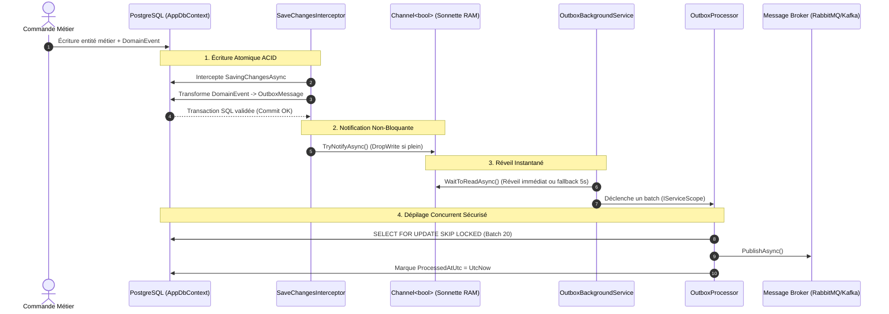

# 📦 Cheatsheet Architecture : Transactional Outbox Pattern & Channels (.NET / PostgreSQL)

> **Tags :** #dotnet #architecture #outbox #postgresql #channels #messaging #resilience #obsidian
> **Projet de référence :** `WorldPinball.Leaderboard` & `WorldPinball.Logistics`

---

## 🎯 Problème résolu : Le Dual-Write Problem

Dans un système distribué, modifier la base de données relationnelle et publier un événement vers un broker (RabbitMQ, Kafka) en deux étapes séparées conduit inévitablement à des pertes de données :
* Si la base commit mais que le broker réseau plante ➔ **Événement perdu**.
* Si le message part sur le broker mais que le commit SQL échoue ➔ **Données fantômes**.

**La Solution :** Sauvegarder l'événement dans la **même transaction ACID** que l'entité métier (`outbox_messages`), puis le dépiler de façon asynchrone et résiliente en arrière-plan.

---

## 📐 Vue d'ensemble du flux (Architecture)



---

## 🏗️ Guide de Construction Étape par Étape (7 Étapes)

### Étape 1 : L'Entité Métier (`Domain/Entities/OutboxMessage.cs`)
```csharp
namespace WorldPinball.Domain.Entities;

public sealed class OutboxMessage(Guid id, string type, string content, DateTime occurredAtUtc)
{
    public Guid Id { get; init; } = id;
    public string Type { get; init; } = type;
    public string Content { get; init; } = content;
    public DateTime OccurredAtUtc { get; init; } = occurredAtUtc;
    public DateTime? ProcessedAtUtc { get; private set; }
    public string? Error { get; private set; }
    public int RetryCount { get; private set; }

    public void MarkAsProcessed(DateTime processedAtUtc) => ProcessedAtUtc = processedAtUtc;
    public void RecordFailure(string error)
    {
        Error = error;
        RetryCount++;
    }
}
```

---

### Étape 2 : Configuration EF Core (`Persistence/Configurations/OutboxMessageConfiguration.cs`)
Index composite indispensable pour garantir des requêtes batch instantanées sans scan de table :
```csharp
public class OutboxMessageConfiguration : IEntityTypeConfiguration<OutboxMessage>
{
    public void Configure(EntityTypeBuilder<OutboxMessage> builder)
    {
        builder.ToTable("outbox_messages");
        builder.HasKey(m => m.Id);

        // Index vital pour le SELECT batch
        builder.HasIndex(m => new { m.ProcessedAtUtc, m.RetryCount, m.OccurredAtUtc });
    }
}
```

---

### Étape 3 : Le Channel / Sonnette Lock-Free (`Services/OutboxNotificationChannel.cs`)
Utilise `System.Threading.Channels` avec l'option `DropWrite` (Signal Coalescing) :
```csharp
using System.Threading.Channels;

public interface IOutboxNotificationChannel
{
    ChannelReader<bool> Reader { get; }
    ValueTask<bool> TryNotifyAsync(CancellationToken ct = default);
}

public sealed class OutboxNotificationChannel : IOutboxNotificationChannel
{
    private readonly Channel<bool> _channel = Channel.CreateBounded<bool>(new BoundedChannelOptions(1000)
    {
        FullMode = BoundedChannelFullMode.DropWrite // Écrase les signaux superflus sans bloquer
    });

    public ChannelReader<bool> Reader => _channel.Reader;

    public ValueTask<bool> TryNotifyAsync(CancellationToken ct = default)
        => new(_channel.Writer.TryWrite(true));
}
```

---

### Étape 4 : L'Interceptor EF Core (`Persistence/Interceptors/ConvertDomainEventsToOutboxMessagesInterceptor.cs`)
Capture les événements du domaine avant commit, puis fait sonner le channel après commit :
```csharp
public sealed class ConvertDomainEventsToOutboxMessagesInterceptor(
    TimeProvider timeProvider,
    IOutboxNotificationChannel channel
) : SaveChangesInterceptor
{
    private readonly ConcurrentDictionary<DbContext, bool> _pending = new();

    public override async ValueTask<InterceptionResult<int>> SavingChangesAsync(
        DbContextEventData eventData,
        InterceptionResult<int> result,
        CancellationToken ct = default)
    {
        var db = eventData.Context;
        if (db is null) return await base.SavingChangesAsync(eventData, result, ct);

        var messages = db.ChangeTracker.Entries<Entity>()
            .Select(e => e.Entity)
            .SelectMany(entity =>
            {
                var events = entity.DomainEvents.ToList();
                entity.ClearDomainEvents();
                return events;
            })
            .Select(evt => new OutboxMessage(
                Guid.NewGuid(),
                evt.GetType().Name,
                JsonSerializer.Serialize(evt, evt.GetType()),
                timeProvider.GetUtcNow().UtcDateTime))
            .ToList();

        if (messages.Count > 0)
        {
            db.Set<OutboxMessage>().AddRange(messages);
            _pending[db] = true;
        }

        return await base.SavingChangesAsync(eventData, result, ct);
    }

    public override async ValueTask<int> SavedChangesAsync(
        SaveChangesCompletedEventData eventData,
        int result,
        CancellationToken ct = default)
    {
        if (eventData.Context is not null &&
            _pending.TryRemove(eventData.Context, out var hasMessages) &&
            hasMessages)
        {
            await channel.TryNotifyAsync(ct);
        }

        return await base.SavedChangesAsync(eventData, result, ct);
    }

    public override Task SaveChangesFailedAsync(
        DbContextErrorEventData eventData,
        CancellationToken ct = default)
    {
        if (eventData.Context is not null) _pending.TryRemove(eventData.Context, out _);
        return base.SaveChangesFailedAsync(eventData, ct);
    }
}
```

---

### Étape 5 : Le Processeur de Batch (`Services/OutboxProcessor.cs`)
Lit les messages par lots de 20 avec verrouillage optimisé pour la concurrence multi-instances :
```csharp
public interface IOutboxProcessor
{
    Task ProcessBatchAsync(CancellationToken ct = default);
}

public class OutboxProcessor(
    AppDbContext db,
    IEventPublisher publisher,
    TimeProvider timeProvider) : IOutboxProcessor
{
    public async Task ProcessBatchAsync(CancellationToken ct = default)
    {
        await using var tx = db.Database.IsRelational() ? await db.Database.BeginTransactionAsync(ct) : null;

        // Requête PostgreSQL haute concurrence (Multi-serveurs sans collisions)
        var messages = await db.OutboxMessages
            .FromSql($"""
                      SELECT * FROM outbox_messages
                      WHERE processed_at_utc IS NULL AND retry_count < 5
                      ORDER BY occurred_at_utc
                      LIMIT 20
                      FOR UPDATE SKIP LOCKED
                      """)
            .ToListAsync(ct);

        if (messages.Count == 0) return;

        var now = timeProvider.GetUtcNow().UtcDateTime;

        foreach (var message in messages)
        {
            try
            {
                await publisher.PublishAsync(message.Type, message.Id.ToString(), message.Content, ct);
                message.MarkAsProcessed(now);
            }
            catch (Exception ex)
            {
                message.RecordFailure(ex.Message);
            }
        }

        await db.SaveChangesAsync(ct);
        if (tx is not null) await tx.CommitAsync(ct);
    }
}
```

---

### Étape 6 : Le Background Worker (`Services/OutboxBackgroundService.cs`)
Le travailleur d'arrière-plan avec réveil hybride (Channel immédiat + Timeout 5s de sécurité) :
```csharp
public sealed class OutboxBackgroundService(
    IServiceScopeFactory scopeFactory,
    IOutboxNotificationChannel channel,
    ILogger<OutboxBackgroundService> logger) : BackgroundService
{
    protected override async Task ExecuteAsync(CancellationToken stoppingToken)
    {
        while (!stoppingToken.IsCancellationRequested)
        {
            using var timeoutCts = CancellationTokenSource.CreateLinkedTokenSource(stoppingToken);
            timeoutCts.CancelAfter(TimeSpan.FromSeconds(5));

            try
            {
                // Attente passive : réveil immédiat sur signal OU après 5 secondes
                await channel.Reader.WaitToReadAsync(timeoutCts.Token);
            }
            catch (OperationCanceledException) when (!stoppingToken.IsCancellationRequested)
            {
                logger.LogDebug("Outbox fallback : vérification périodique après 5s.");
            }

            // Vidage des sonnettes redondantes en mémoire
            while (channel.Reader.TryRead(out _)) { }

            try
            {
                // CRUCIAL : Scope obligatoire car IOutboxProcessor utilise un DbContext Scoped
                using var scope = scopeFactory.CreateScope();
                var processor = scope.ServiceProvider.GetRequiredService<IOutboxProcessor>();
                await processor.ProcessBatchAsync(stoppingToken);
            }
            catch (Exception ex) when (!stoppingToken.IsCancellationRequested)
            {
                logger.LogError(ex, "Erreur lors du traitement d'un lot outbox.");
            }
        }
    }
}
```

---

### Étape 7 : Enregistrement dans le Conteneur DI (`Program.cs`)
Tableau récapitulatif des durées de vie des composants :

| Composant | Durée de vie (Lifetime) | Raison technique |
| :--- | :--- | :--- |
| `IOutboxNotificationChannel` | **Singleton** | Doit être partagé par toutes les requêtes HTTP pour sonner le même worker |
| `ConvertDomainEventsToOutboxMessagesInterceptor` | **Singleton / Scoped** | Doit recevoir le channel singleton pour déclencher le signal |
| `AppDbContext` | **Scoped** | Cycle de vie standard par requête HTTP |
| `IOutboxProcessor` | **Scoped** | Dépend directement de `AppDbContext` |
| `OutboxBackgroundService` | **HostedService (Singleton)** | Démarre au lancement de l'application et tourne indéfiniment |

```csharp
// Program.cs
builder.Services.AddSingleton<IOutboxNotificationChannel, OutboxNotificationChannel>();
builder.Services.AddSingleton<ConvertDomainEventsToOutboxMessagesInterceptor>();

builder.Services.AddDbContext<AppDbContext>((sp, options) =>
{
    options.UseNpgsql(connectionString)
           .AddInterceptors(sp.GetRequiredService<ConvertDomainEventsToOutboxMessagesInterceptor>());
});

builder.Services.AddScoped<IOutboxProcessor, OutboxProcessor>();
builder.Services.AddHostedService<OutboxBackgroundService>();
```

---

## ⚡ Résumé des Points Clés pour Entretien / Conception
1. **Pourquoi l'Outbox ?** Garantit une sémantique de livraison **At-Least-Once** sans jamais bloquer la transaction HTTP du client.
2. **Pourquoi `FOR UPDATE SKIP LOCKED` ?** Permet d'avoir 10 répliques de l'API en parallèle sans verrouillage de table ni doublons de traitement.
3. **Pourquoi `System.Threading.Channels` avec `DropWrite` ?** Réduit la latence de publication à ~1 ms (quasi instantané) tout en amortissant les tempêtes de trafic sans aucune allocation mémoire excessive.
